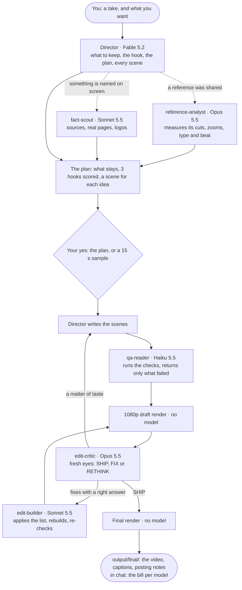

# Fable-Directed Editor

**Drop in a talking-head recording, get back a video ready to post.** A local editor driven by
[Claude Code](https://claude.com/claude-code): it cuts the pauses and fillers without ever chopping a sentence, adds
word-by-word captions, motion graphics, music and a colour grade, then checks the result before you see it. It makes
9:16 shorts and reels, and 16:9 YouTube videos. Everything runs on your Mac: no cloud editor, no paid renderer.

[](https://youtu.be/qVN2dI49aq0)

**Watch the walkthrough (about 5 minutes):** what one edit cost, and who does what in this editor. Click the picture
to play it on YouTube.

| | |
|---|---|
| **You give it** | a recording of you talking, and optionally a video to "edit it like" |
| **You get** | a finished video, `captions.srt` and posting notes in `output/final/<video>/`, and the bill per model in Claude's last message |
| **Runs on** | a Mac with Apple silicon. Speech to text (whisper.cpp), the cuts, the grade and the renders are all local |
| **Needs** | [Claude Code](https://claude.com/claude-code) signed in with a Claude Pro or Max plan |
| **You decide** | before anything is built: the plan (a full video) or a 15 second sample (a Reel or a new look) |

## An edit, start to finish

You open the folder in Claude Code and type one line:

> Make a Reel from ~/Downloads/take.mp4. Edit it like this one: https://www.youtube.com/shorts/...

One session, the director, runs the edit and hands the checkable work to five helpers:



What happens at each step:

1. **Intake.** The take is copied to `output/jobs/` and transcribed on your Mac. Claude reads the transcript and a
   contact sheet of the footage.
2. **The helpers start.** A reference you shared is measured (cuts a minute, zoom sizes and speeds, caption rhythm,
   the beat) and written up as a style spec. Any product, price, number or quote the video will show gets a dated
   source and the real page.
3. **The plan.** What to keep, in whole sentences. Three openings, scored. One scene for each idea in the talk.
4. **Your yes.** For a full video you see the plan. For a Reel or a new look you get a 15 second sample. Every
   question comes in that one message.
5. **Build, check, draft, review.** The director writes the scenes. The checks run (sentences whole, nothing off
   screen, loudness, frozen or black frames). A critic that never saw the build notes reviews the draft, and fixes go
   round at most three times.
6. **Delivery.** One full-quality render, then the video, `captions.srt` and posting notes in `output/final/<video>/`.
   Claude's last message says what the edit cost per model and which helpers worked on it.

## The crew

| Who | What it does | Model |
|---|---|---|
| **Director** (the session you talk to) | everything a viewer sees or hears: what to keep, the hook, the plan, each scene's design, the sound choices | Fable 5.2 |
| `reference-analyst` | studies a reference video you share and writes its style spec | Opus 5.5 |
| `edit-critic` | reviews a rendered draft with fresh eyes, a new one each round | Opus 5.5 |
| `fact-scout` | checks the facts and captures the real pages and logos an edit shows | Sonnet 5.5 |
| `edit-builder` | applies an exact fix list, rebuilds and re-checks | Sonnet 5.5 |
| `qa-reader` | runs the text checks and reads their reports and render logs | Haiku 5.5 |

Renders, grades and transcription are shell commands on your Mac and use no model.

The rule behind the split: a task goes to a cheaper model only if a check can confirm the result. Taste stays with
the director. The roles and the order of the run are in `.claude/skills/fable-director/SKILL.md`; the helpers are
the files in `.claude/agents/`.

To change who runs on what, edit `model` in `.claude/settings.json` (the director) or the `model:` line of a helper's
file. If your plan does not offer one of these models, set one it does; the roles stay the same.

## Quick start

On a Mac with Apple silicon, with [Homebrew](https://brew.sh), Google Chrome and Claude Code installed:

```bash
xcode-select --install                                      # once, if you don't have the command line tools yet
git clone https://github.com/DhananjaySarathe/fable-directed-editor.git "fable-directed-editor"
cd "fable-directed-editor"
./setup.sh                                                  # about 20-30 min the first time: mostly downloads
echo 'export HYPERFRAMES_NO_UPDATE_CHECK=1' >> ~/.zshrc     # keeps the video renderer on its tested version
claude                                                      # opens Claude Code in this folder
```

`uv run shorts doctor` checks that everything is in place. Then ask Claude: *"Make a short from ~/Downloads/take.mp4"*.

### Try it with no footage first

`kit/film/example/` is a complete small film on a generated take (a test pattern and your Mac's built-in voice). Run
it once to see every step work before your first real edit. It takes a few minutes and uses no Claude session:

```bash
uv run python kit/film/example/make_take.py                 # makes the "recording"
uv run python -m kit.film kit/film/example prep             # transcribe, clean the voice
uv run python -m kit.film kit/film/example cut              # the cut, checked for whole sentences
uv run python -m kit.film kit/film/example joins            # listens to every join again
uv run python -m kit.film kit/film/example grade            # the colour grade
uv run python -m kit.film kit/film/example draft            # graphics, mix, a 1080p draft, the QA check
```

The draft lands in `output/temp/films/kit-film-example/renders/draft_av.mp4`, and near the end of the output you should
see `PASS: draft_av.mp4`.

## What to ask for

> Make a short from ~/Downloads/take.mp4

> Edit ~/Movies/talk.mov into a YouTube video with graphics

> Make a Reel from ~/Downloads/take.mp4 and edit it like this one: (a link or a file)

> This is a two-person podcast recorded on one camera. Cut it into an episode: ~/Movies/episode.mov

> What did the last edit cost, per model?

The `fable-director` skill runs the edit, with the `video-shorts` skill as the kit's manual. Other skills cover a
look or a format and load when you name them: `canvas-studio` (the default look), `paper-collage`, `podcast`,
`documentary`.

Every edit starts by copying the take in and transcribing it:

```bash
uv run shorts probe ~/Downloads/take.mp4 --job take1    # output/jobs/take1/source.mp4 + probe.json
uv run shorts analyze take1                             # analysis.json: words, sentences, pauses, face, loudness
```

Then a Reel follows `kit/reel/README.md` (`uv run python -m kit.reel films/<name> prep|edl|joins|sample|render`), and a
long-form film follows `kit/film/README.md` (`uv run python -m kit.film films/<name> prep|cut|joins|grade|build|draft|render`)
with the look's README in `kit/presets/`.

## What an edit costs

```bash
uv run python kit/cost.py                    # this project's sessions, newest first, per model
uv run python kit/cost.py --limit=1 --crew   # the latest session, and which helpers worked on it
```

It reads Claude Code's own session logs and prices the tokens at Anthropic's API list prices. This is the edit that
started this project, where one model did everything (output shortened):

```text
be0e65dd  Edit YouTube video   2026-11-09, 5.6 h   $124.28
  main:              claude-fable-5-2   400 msgs   out 0.73M   read 212.58M   write 2.14M   $105.78
  critic, round 1    claude-fable-5-2    40 msgs   out   76k   read   7.99M   write 0.32M     $7.86
  critic, round 2    claude-fable-5-2    85 msgs   out   97k   read  17.15M   write 0.33M    $10.64
  where it went: re-reading the conversation $47.54 (38%), new context $40.80 (33%), output and thinking $35.93 (29%).
```

How to read it:

- **Re-reading the conversation** is the part that grows: every turn re-reads everything before it, so a long
  session full of check output pays for that output again and again.
- **New context** is tool output, files and images, paid once when they arrive.
- **Output and thinking** is the actual directing.
- **`--crew`** adds which helpers ran, which never started, and how many checks the director ran itself. If the
  director is running the checks, the cheap work is being done at the expensive price; the skill tells it to look at
  this line after the first draft and at the end.

On a Pro or Max plan you are not billed these dollars: they show which model and which part of a session used the
most. Whether the split lowers your own bill depends on the edit, so read the line after each one.

**Matching a reference:** share a video and say "edit it like this". `kit/refs/breakdown.py` measures its cuts, zooms,
captions and beat from the frames and the audio, and `kit/refs/compare.py` puts your draft beside it. They are
measurements to steer the edit by; judge the result by eye.

## Make it yours

The repo ships its author's look and identity in a few places. Change these before your first long-form video:

- **Name and handle** in the long-form preset: the lower third and end card in `kit/presets/paper_studio/templates/longform.html` and `templates/reel.html`, and the showcase (`kit/hf/showcase/src/template.html`).
- **Design tokens** (palette, fonts, motion): `kit/presets/paper_studio/preset.json` and `kit/hf/paper.css`.
- **Your handles** for end cards: `kit/brand.json` (it ships with placeholders).
- **Your taste:** `kit/refs/OWNER_DEFAULTS.md` holds the standing rules every edit follows (pace, zooms, layouts,
  sound levels, what needs your yes). They are the author's defaults: edit the file, or tell Claude a preference and
  ask it to write it there.
- **Your films** go in `films/<video>/`, one folder per video. `kit/film/example/` is a complete small film on a
  generated take: run its commands once to see every step work before your first real edit.

Claude Code builds up its own memory of your preferences as you edit.

## Under the hood

- **Hear:** whisper.cpp transcribes, keeping fillers. A wav2vec2 aligner and the audio envelope give word times accurate to about 30 ms. Hindi is written as romanised Hinglish.
- **Look:** ffmpeg, OpenCV and Apple Vision find the face, blur and shot changes. Claude reads timecoded contact sheets.
- **Decide:** the editing questions (false starts, fillers, pauses, retakes, zoom-ins) are answered by Claude. Cuts land only in silence, and a checker refuses any edit that chops a sentence or splices two half-sentences.
- **Graphics:** a HyperFrames component kit (`kit/hf/`): a speaker camera with a director, diagrams, screen demos, code, kinetic type with springs, sketch and collage styles, a stick-figure rig, and the Reel scene library (`kit/hf/reel.js`). The older template library in `kit/graphics/` is kept as the fallback list `kit/hf/plan_check.py` checks against.
- **Look and sound:** a face-aware colour grade, the speaker cut out for words-behind-head shots, a music and sound-effect library, mastered to −14 LUFS.
- **Check:** the final file is checked for size, frame rate, duration, loudness, true peak, black or frozen picture and cropped sentences, then a fresh Claude critic reviews it.

Why `HYPERFRAMES_NO_UPDATE_CHECK=1`: HyperFrames otherwise upgrades itself in the background, even mid-render, which
crashes that render and breaks the tested version. Claude Code runs in this folder already get it from
`.claude/settings.json`. To move to a newer HyperFrames on purpose, change `HYPERFRAMES_VERSION` in `shorts/config.py`
and re-run `./setup.sh`.

<details>
<summary><b>What gets installed, where, and how big it is</b></summary>

**Install these yourself first** (`setup.sh` checks for them):

| What | Why it's needed | Where it goes | How to install | Size |
|---|---|---|---|---|
| Homebrew | installs the tools below | `/opt/homebrew` | the one-line command on [brew.sh](https://brew.sh) | varies |
| Xcode Command Line Tools | builds the two Apple Vision tools | `/Library/Developer/CommandLineTools` | `xcode-select --install` | 1.3 GB |
| Google Chrome | draws the graphics and renders the compositions | `/Applications` | [google.com/chrome](https://www.google.com/chrome/) | 720 MB |
| Claude Code | runs the editing | your user folder | [claude.com/claude-code](https://claude.com/claude-code) | |

**`./setup.sh` installs the rest** (safe to re-run; anything already there is skipped):

| What | Why it's needed | Where it goes | Command it runs | Size |
|---|---|---|---|---|
| ffmpeg | cutting, encoding, loudness, checks | `/opt/homebrew` | `brew install ffmpeg` | 770 MB with its libraries |
| whisper.cpp | speech to text | `/opt/homebrew` | `brew install whisper.cpp` | 6 MB (+150 MB shared libraries) |
| uv, node | run the Python and JavaScript parts | `/opt/homebrew` | `brew install uv node` | 120 MB |
| Python packages (OpenCV, ONNX Runtime, numpy...) | the editor itself | `.venv/` in this folder | `uv sync` | 540 MB |
| Node packages (Chrome driver, GSAP, rough.js) | graphics rendering | `node_modules/` in this folder | `npm install` | 60 MB |
| HyperFrames 0.8.134 | renders long-form compositions | the global npm folder | `npm install -g hyperframes@0.8.134` | 120 MB |
| Whisper large-v3-turbo (q5) | transcription | `kit/models/` | `uv run shorts setup` | 574 MB |
| SaT sentence model + tokenizer | finds sentence ends, so no cut lands mid-sentence | `kit/models/hf/` | `uv run shorts setup` | 421 MB |
| wav2vec2 aligner (int8) | word timings to about 30 ms | `kit/models/` | `uv run shorts setup` | 95 MB |
| Smart Turn, Silero VAD, YuNet | end of a thought, speech vs pause, face detection | `kit/models/` | `uv run shorts setup` | 11 MB |
| Apple Vision tools | person cut-outs, text on screen | `kit/bin/` | built by `uv run shorts setup` | under 1 MB |
| Music and sound effects | background tracks and hits | `kit/music/`, `kit/sfx/` | `uv run python kit/assets_src/fetch.py` | 240 MB |

In total: about **1.9 GB inside this folder**, plus up to about **3 GB of system tools** if you have none of them yet,
plus room for your footage and renders in `output/`. `uv run shorts doctor` checks that everything is in place. The
fonts (3.5 MB) come with the repo.

</details>

## Where files go

Everything the pipeline generates lands in `output/` (git-ignored), never in `films/` or `kit/`:

| Folder | What | Keep? |
|---|---|---|
| `output/final/<video>/` | the video(s) to upload, `captions.srt`, posting notes, the final contact sheet | yes |
| `output/jobs/<take>/` | one recorded take: `source.mp4` (the footage copy), `probe.json`, `analysis.json` (transcript) | while you might re-edit it |
| `output/music_usage.json` | which track each video used, so the next videos don't repeat it | yes |
| `output/temp/` | everything else: audio extracts, whisper output, face tracks, graphics frames, previews, cut A-roll, grades, mixes, raw renders, snapshots, one-off scripts, caches | **delete any time** |

```bash
uv run shorts clean --dry-run   # what would go, and how big it is
uv run shorts clean             # delete all of output/temp
uv run shorts clean take1       # only one take's (or film's) temp files
```

Deleting `output/temp` loses nothing you need: re-running a step rebuilds what it made. `films/<video>/` keeps only a
film's recipe (edl.py, build.py, the template, edl.json and its screenshots). Film scripts find every folder through
`kit/paths.py` (`F = Film(__file__)`); run them with `uv run python`.

## Claude Code cloud sessions (Linux)

`cloud-setup.sh` is the Linux counterpart of `setup.sh`. The `SessionStart` hook in `.claude/settings.json` runs it
automatically in cloud sessions (only when `CLAUDE_CODE_REMOTE=true`, so it never fires on a Mac). Leave the cloud
environment's own setup script empty. Its output goes to `/tmp/cloud-setup.log`.

A cloud session can edit code, run the tests and build graphics. Grading, person cut-outs, OCR boxes and full renders
need macOS (Apple Vision, Chrome in `/Applications`), so they stay on the Mac. The speech and face models are skipped by
default. Run `CLOUD_MODELS=1 ./cloud-setup.sh` to download them (needs Full network access). Cloud sessions clone
from GitHub, so a push is all it takes to update them.

## Music and sound effects

The music and the downloaded sound effects are not in this repository: their licences (NCS, Mixkit and others) don't
allow passing them on. (The 13 basic sounds in `kit/sfx/` itself were synthesised by this project and are included.)
`./setup.sh` downloads each track from its source (`kit/assets_src/fetch.py`, listed in `kit/music/library.json` and
`kit/sfx/library.json`; about 10 minutes the first time); a few tracks have no public download and are simply skipped. Credits are in
`kit/music/CREDITS.md`: paste the block into your video description when a track asks for one. Add your own tracks to
`kit/music/<mood>/` and `kit/music/library.json`.

## Licences of what's bundled or downloaded

- **Fonts** (`kit/fonts/`, in the repo): all under the SIL Open Font License 1.1, which allows sharing them with their
  licence; each family's licence text is in `kit/fonts/licenses/`.
- **Models**: not in the repo. `uv run shorts setup` downloads them from their official sources, each under its own
  permissive licence (MIT, Apache-2.0 or BSD).
- **Music and sound effects**: not in the repo (see above). You download them from their sources yourself, and the
  track's own terms apply to your videos: credit NCS tracks as `kit/music/CREDITS.md` shows.
- **Python and npm packages**: installed from PyPI and npm under their own licences.

## Tests

```bash
uv run pytest            # unit and slow media tests
uv run pytest kit/cut    # the cut checker's unit tests
```
